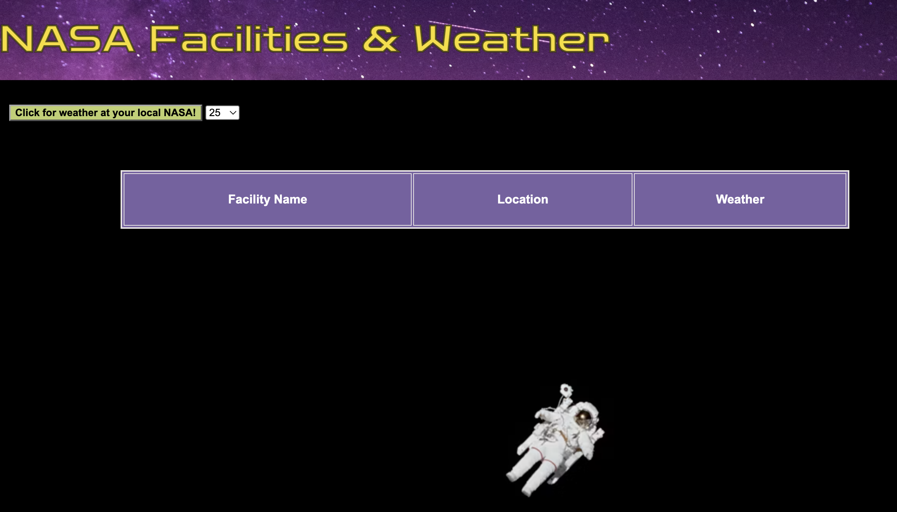

# 🚀 Project: Complex NASA API

### Goal: Use NASA's API to return all of their facility locations (~400). Display the name of the facility, its location, and the weather at the facility currently. 

### Features: 
Ever wanted to know the locations of ALL of NASA's facilities? Click the button and find the closest facilty near you! 

View all ~400 NASA facilities and the weather at each location. This app uses the [NASA facilities API](https://data.nasa.gov/dataset/nasa-facilities-api/resource/8da12948-3793-4ec1-b5c6-f95e86fd6021) to print all facilities to the DOM. It also uses a [weather api](https://www.weatherapi.com/docs/) to print the weather for each respective facility.

### Issues: 
- Understanding how to fix the CORS issue took a lot of time.
- There was some minor confusion about how to best use a table to hold all the information. 
- It was difficult to style elements that were created in JavaScript file.

### Tech Stack: 
- HTML, CSS, JavaScript

### How to Use:
- Click the link in the about section of this repo to the right or simply [CLICK HERE](https://priscilla-ruilova.github.io/Complex-NASA-api/)
- Press the 'Click for weather at your local NASA!' button and view 25, 50, 100, or all 425 NASA locations and the weather at each facility.

